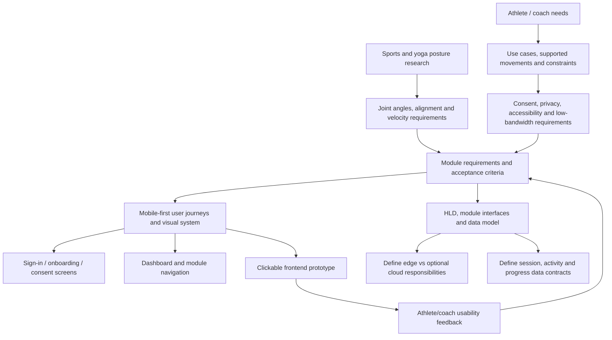
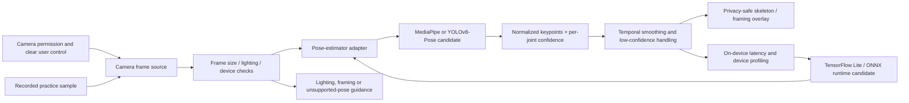
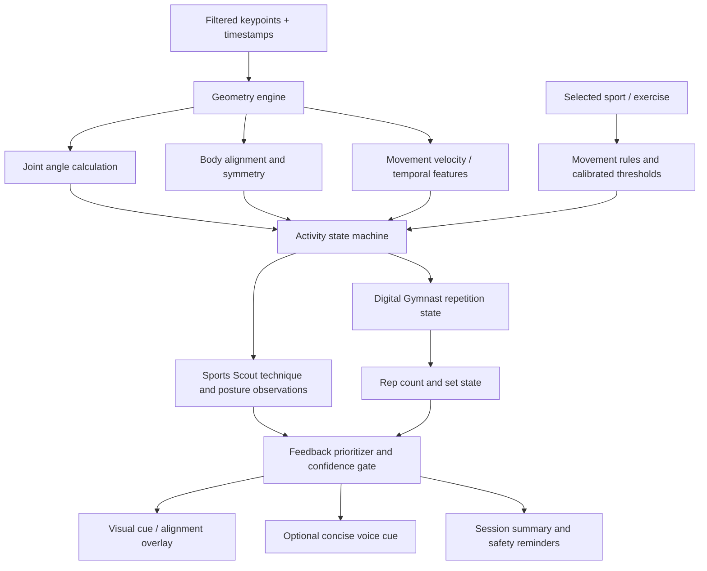
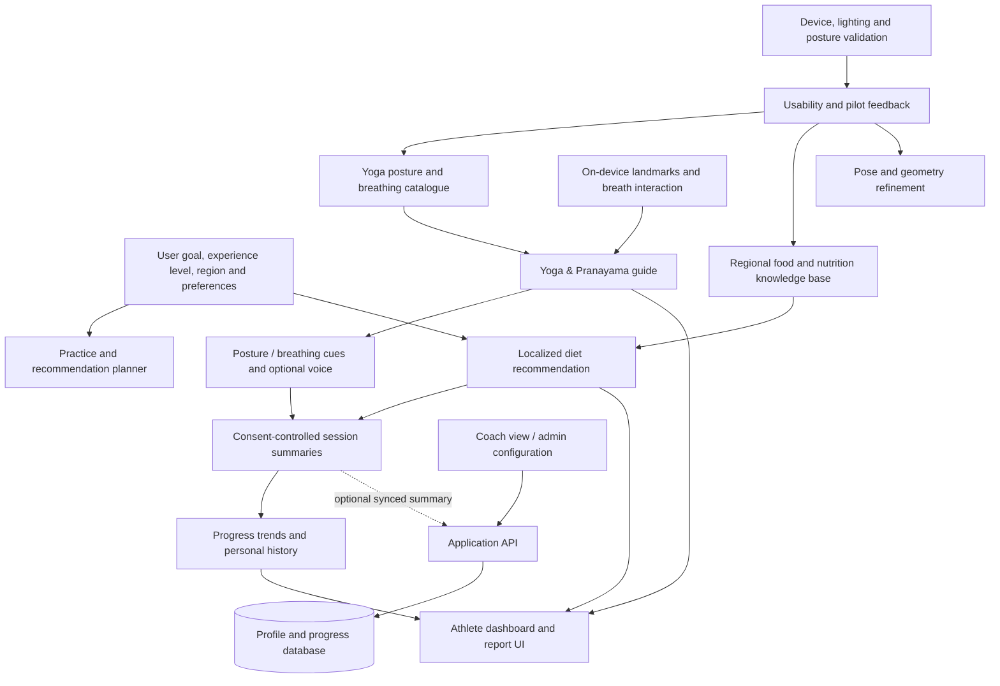

# SwasthyaDrishti — High-level and low-level design

**Basis:** `Project Synopsis.pdf` (PIET/CS/FYP/PS-124) and the SwasthyaDrishti 30-user-story sprint backlog. The sprint slices below organize the synopsis phases and backlog goals into an iterative implementation plan; they are design views, not claims that every listed task has been implemented.

## High-level design (HLD)

```mermaid
flowchart LR
  USER[Athlete / fitness practitioner] --> CLIENT[Web dashboard / Android app]
  CLIENT --> CONSENT[Profile, goals, consent and activity selection]
  CONSENT --> CAPTURE[Camera capture: phone camera or webcam]
  CAPTURE --> EDGE[On-device inference boundary]
  subgraph DEVICE[User device — privacy-first edge pipeline]
    EDGE --> POSE[Pose estimation: MediaPipe / YOLOv8-Pose]
    POSE --> KEY[Body keypoints with confidence]
    KEY --> GEOM[Geometry engine: angles, alignment and movement]
    GEOM --> ROUTER[Activity-specific analysis router]
    ROUTER --> SCOUT[Sports Talent Scout]
    ROUTER --> GYM[Digital Gymnast]
    ROUTER --> YOGA[Yoga & Pranayama]
    SCOUT --> FEEDBACK[Visual and optional voice feedback]
    GYM --> FEEDBACK
    YOGA --> FEEDBACK
  end
  PROFILE[User goals, level, region and food preferences] --> DIET[Localized diet recommendation]
  PROFILE --> HISTORY[Progress and analytics]
  FEEDBACK --> HISTORY
  HISTORY --> CLIENT
  DIET --> CLIENT
  COACH[Coach / training group] --> CLIENT
  CLIENT -.only consented summaries and sync, if enabled.-> API[Optional application API]
  API --> DB[(Profile and progress store)]
  ADMIN[Admin] --> API
```

### HLD responsibilities and trust boundaries

- The client handles onboarding, consent, activity selection, camera permission UX, live overlays, feedback, accessible controls and progress views.
- The on-device pipeline is the proposed core: camera frames → pose landmarks → geometry/features → activity logic → visual or voice cues. Raw video should remain on-device under the synopsis privacy goal.
- Sports Scout evaluates selected sports movements and presents posture, joint-angle and technique observations with uncertainty. Any injury-risk signal is informational coaching support, not diagnosis.
- Digital Gymnast tracks exercise state/repetitions and provides form cues from movement landmarks.
- Yoga & Pranayama guides a selected posture/breathing exercise and offers gentle posture or breathing prompts.
- Diet guidance uses the user's goal and regional food preferences to select localized food suggestions. It should be general wellness information, not medical nutrition advice.
- The optional backend is for account/profile synchronization, progress summaries, coach views and administration. It is not required for the camera inference path. API/database choices must be finalized during implementation.
- The synopsis names React.js, React Native/Android, FastAPI/Flask or Node, MediaPipe/OpenCV, NumPy geometry, TensorFlow Lite/ONNX, and MongoDB/PostgreSQL/Firebase as candidate technologies, not final selections.

## Low-level design (LLD) — Sprint 1: requirements, foundation and experience design

**Derived from synopsis phases 1–2:** requirements gathering, sports/yoga movement research, scope finalization, end-to-end architecture, database design and low-bandwidth-first UX prototype.

**Module outputs:** requirements and movement catalogue; consent/privacy flow; initial data contracts; architecture and UI prototype. No live pose model is implied at this stage.

## Low-level design (LLD) — Sprint 2: camera and pose-estimation foundation

**Derived from synopsis phase 3:** implement camera input and integrate MediaPipe or YOLOv8-Pose, targeting lightweight edge execution.

**Module outputs:** camera abstraction; pose adapter; keypoint format; confidence and quality handling; device benchmark. Do not persist or upload raw frames by default.

## Low-level design (LLD) — Sprint 3: geometry engine and live coaching modules

**Derived from synopsis phase 4:** implement movement geometry and real-time feedback for Sports Talent Scout and Digital Gymnast.

**Key interfaces:** `LandmarkFrame`; `JointMetrics`; `MovementState`; `CoachingCue`; `SessionEvent`. Low landmark confidence should suppress specific corrective prompts and request a better camera view instead. Keep movement rules activity-specific and explain coaching cues in simple language.

## Low-level design (LLD) — Sprint 4: yoga, nutrition, progress and integration

**Derived from synopsis phases 5–9:** Yoga & Pranayama, localized diet suggestions, dashboard/admin integration, device and usability validation, pilot feedback and refinement.

**Key boundaries:** retain only the minimum session summaries needed for progress; expose deletion and consent controls; regional food suggestions should explain portions and substitutions without medical claims; coach/admin access requires explicit product and privacy requirements.

## Frontend page and interaction map

| Page/interaction | Synopsis requirement represented |
|---|---|
| Login and entry to wellness dashboard | First-use web product shell; demo-only name/password |
| Athlete overview and practice history | Progress tracking and analytics |
| Sports Scout preview | Sports posture, alignment and movement feedback |
| Digital Gymnast preview | Repetitions and exercise-form correction |
| Yoga & Pranayama module | Guided movement and breathing practice |
| Local nutrition ideas | India-relevant regional food guidance concept |
| In-app guide chat UI | Frontend-only help interface; canned local replies |
| Privacy messaging | Camera-only and on-device processing goal from synopsis |

The React frontend has no server or model calls. Sample analytics are illustrative; the camera practice screen is a visual preview and does not request camera access or run pose estimation.
